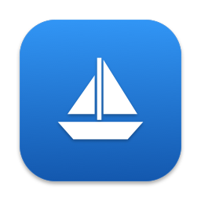
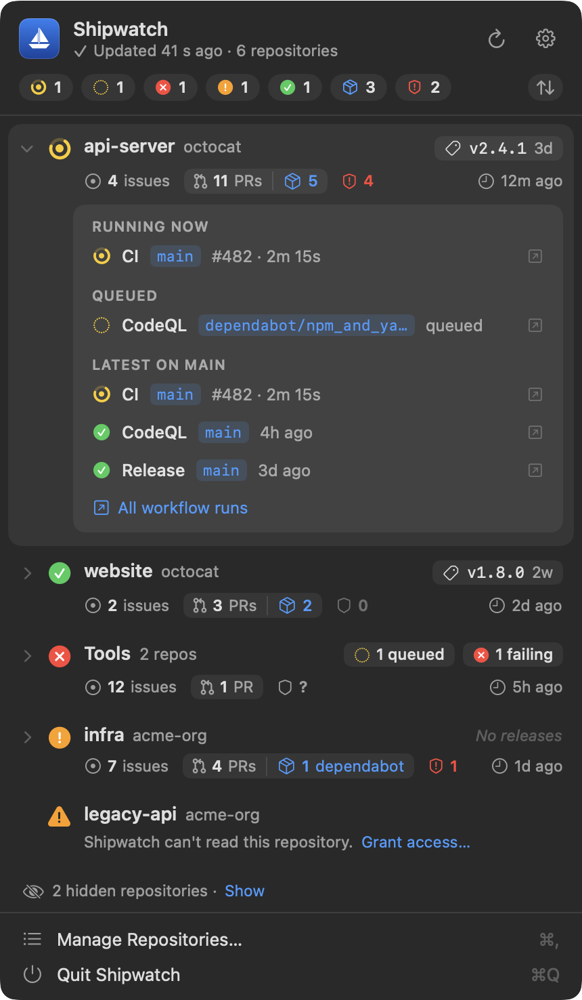

  

<h1 align="center">Shipwatch</h1>

  
  
  
  

  <a href="docs/README.md">Documentation</a> ·
  <a href="https://github.com/mbianchidev/shipwatch/releases">Releases</a> ·
  <a href="https://github.com/mbianchidev/shipwatch/issues/new/choose">Report a bug or request a feature</a>

  

Shipwatch is a tiny macOS menu bar app for people who maintain several GitHub
repositories. Click the sailboat and see, for every repository you pick, the
latest release, whether Actions is passing, failing, running, queued or blocked by
config/billing, the last activity, and how many issues and pull requests are
open, with Dependabot pull requests counted separately. Every item links to the matching GitHub page.

## Contents

- [Quickstart](#quickstart)
- [Why Shipwatch](#why-shipwatch)
- [How it works](#how-it-works)
- [Get started](#get-started)
- [Features](#features)
- [Documentation](#documentation)
- [AI policy](#ai-policy)
- [Contributing](#contributing)
- [Security](#security)
- [License](#license)

## Quickstart

Requires macOS 14 Sonoma or later, on Apple Silicon or Intel.

1. Install with [Homebrew](https://brew.sh):
   `brew install --cask mbianchidev/tap/shipwatch`. Or download
   `Shipwatch.dmg` from the
   [latest release](https://github.com/mbianchidev/shipwatch/releases/latest).
2. Without Homebrew, open the DMG and drag **Shipwatch** onto **Applications**.
3. Open Shipwatch from Applications. Releases are ad-hoc signed, not notarized,
   so macOS may block the first launch: click **Done**, then **Open Anyway** in
   **System Settings > Privacy & Security**. See
   [First launch](docs/installation.md#first-launch).
4. Click the sailboat in the menu bar and choose **Sign in with GitHub**
   (read-only) or **Use GitHub CLI token**.
5. Click **Add Repositories…** and pick a few.

The list now shows a row per repository with its release, Actions status,
activity, issues and pull requests.

If Shipwatch says "This build has no GitHub App Client ID", register your own
read-only app as described in [GitHub App setup](docs/github-app-setup.md), or
use the GitHub CLI option. To build from source, see
[Development](docs/development.md).

## Why Shipwatch

- **One glance instead of many tabs.** Releases, CI and open work for all your
  repositories in one list.
- **Dependabot apart.** `11 PRs (5 dependabot)` tells you how much is real
  review work, and each count opens the matching list.
- **Read-only.** The GitHub App only asks for read permissions, and Shipwatch
  never changes anything on GitHub.
- **Light on rate limits.** One GraphQL query per 10 repositories, and workflow
  run requests that come back as `304 Not Modified` when nothing changed.
- **No server, no analytics.** Shipwatch talks to GitHub directly and keeps the
  token in your login Keychain.
- **Verified updates.** New versions are installed only after their Ed25519
  signature checks out, and rolled back if they fail to start.

Tradeoffs:

- macOS only, version 14 or later.
- Not Developer ID signed or notarized, so the first launch needs **Open Anyway**.
- It polls: changes appear on the next refresh, every 2 minutes by default and
  every 20 seconds while a workflow runs.
- github.com only; GitHub Enterprise Server is not supported.

## How it works

Shipwatch is a SwiftUI list in an AppKit menu bar item. On each refresh it reads
the token from the Keychain (or `gh`), sends one GraphQL query per 10
repositories for releases, counts and dates, and one conditional REST request per
repository for recent workflow runs, plus one for the jobs of each new failure to
spot runs that never started (config/billing). Running beats queued, queued beats
failing, failing beats config/billing, config/billing beats passing; only the latest completed run
of each workflow on the default branch decides, so a red run fixed later is
ignored. With clone sync on, it then runs `git fetch` and a fast-forward-only
update in your local clones whose default branch is behind. A bundled helper installs
verified updates and rolls back on failure. Details are in
[Architecture](docs/architecture.md).

## Get started

Open Settings with **Manage Repositories…** at the bottom of the list (Cmd-comma).

- **Repositories:** add, reorder, group, hide, show and remove repositories, and
  check which ones your sign-in can read.
- **Workspace:** optionally keep the default branch of your local clones up to
  date, with folders to exclude from the scan.
- **General:** refresh interval (2 minutes by default), what last activity means,
  pre-releases, security alerts, a running or failing count in the menu bar,
  launch at login and updates.
- **Account:** sign-in method, repository access and your own GitHub App.

Every setting and its default is in [Usage](docs/usage.md). For problems, see
[Troubleshooting](docs/troubleshooting.md).

## Features

- Latest release tag and age per repository, or **No releases**.
- Actions status: checkmark passing, xmark failing, exclamation mark
  config/billing (jobs never started), spinning ring running, dotted circle queued.
  Expand a row for the running and queued runs and the latest run of each
  workflow, each linking to GitHub.
- Status chips that filter the list to running, queued, failing, config/billing or
  passing repositories, or to those with open Dependabot pull requests.
- Optional: open Dependabot, code scanning and secret scanning alerts per
  repository, with a chip that lists the repositories that have any.
- Sort the list by your custom order, name or last activity.
- Collapsible groups that sum their repositories' issues and pull requests and
  show whether any CI is running, queued or failing.
- Renamed and transferred repositories are followed automatically.
- Last activity: last push, or any update to issues, pull requests and comments.
- Open issue count, linking to the issue list.
- Open pull request count with Dependabot pull requests split out, each linking
  to its list.
- A sailboat menu bar icon with a yellow dot while workflows run or wait in the
  queue, plus the number of running (or failing) repositories.
- Sign-in through a read-only GitHub App device flow, or your existing `gh` login.
- Optional: keep `main` of your local clones current. Pick a workspace folder,
  exclude folders, and Shipwatch fast-forwards each clone's default branch when
  GitHub has new commits. It never commits, resets, stashes or switches
  branches, and skips clones with local changes.
- In-app updates from GitHub Releases, checked every 6 hours by default.

## Documentation

User guides and developer docs live in [`docs/`](docs/README.md):
[Installation](docs/installation.md), [Usage](docs/usage.md),
[Updates](docs/updates.md), [Troubleshooting](docs/troubleshooting.md),
[Development](docs/development.md), [Architecture](docs/architecture.md) and
[Releases](docs/releases.md).

## AI policy

You are responsible for everything you contribute, including AI-assisted code,
documentation, and assets. Review and test your contribution. Be able to explain
what the code does and why it is needed.

## Contributing

Contributions are welcome. Read [CONTRIBUTING.md](CONTRIBUTING.md) and the
[Code of Conduct](CODE_OF_CONDUCT.md). Coding agents start with
[AGENTS.md](AGENTS.md).

## Security

Report vulnerabilities privately through
[GitHub private vulnerability reporting](https://github.com/mbianchidev/shipwatch/security/advisories/new),
not in public issues. See [SECURITY.md](SECURITY.md).

## License

Shipwatch is released under the [MIT License](LICENSE).
