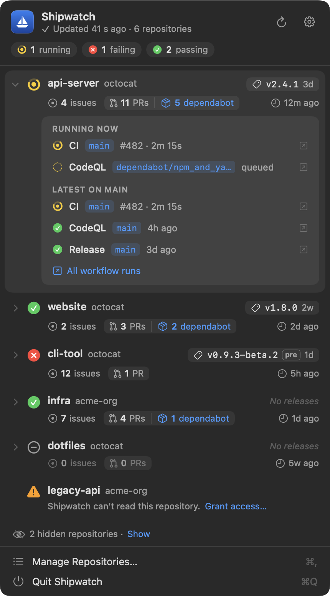

# Usage

## Menu bar

Shipwatch shows a sailboat in the menu bar.

| Icon | Meaning |
| --- | --- |
| Sailboat only | Every visible repository is passing or has no runs |
| Yellow dot | A workflow is running or queued somewhere |
| Red dot | At least one repository is failing on its default branch |

Turn on **Show failing count in menu bar** to also show how many repositories
are failing. Left-click the sailboat to open the list. Right-click it for
**Refresh** (Cmd-R), **Settings…** (Cmd-comma), **Check for Updates…** and
**Quit Shipwatch** (Cmd-Q). When a newer Shipwatch is out, a line above
**Manage Repositories…** offers **Install**; see [Updates](updates.md).
The same shortcuts work while the list is open.

## Repository rows

  

Each visible repository shows:

| Item | Click to open |
| --- | --- |
| `owner/name` | the repository |
| Latest release tag and age (or **No releases**) | that release |
| Actions status: checkmark passing, xmark failing, dotted circle running | expands the row with running runs and the latest run per workflow on the default branch; each run links to GitHub |
| Open issues | the open issues list |
| Open pull requests | the open pull requests list |
| `N dependabot` | open pull requests by `app/dependabot` |
| Last activity | (hover for the exact date) |

Failing means the latest completed run of any workflow on the default branch
failed. A red run that was fixed by a later run is ignored. Running beats
failing, failing beats passing.

Right-click a row for **Open Repository**, **Open Actions**, **Open Releases**,
**Copy Latest Tag**, **Move Up**, **Move Down**, **Hide** and
**Remove from Shipwatch…**. Removing or hiding never changes anything on GitHub.

## Settings

Open Settings with **Manage Repositories…** (Cmd-comma) at the bottom of the list, or
**Settings…** in the right-click menu.

### Repositories

The repositories shown in the list, in order.

- Click **+** to pick repositories your token can read. Filter the list, or type
  `owner/name` to add one that isn't listed.
- Drag rows to reorder.
- Click the eye to hide or show a repository. Hidden ones stay configured and are
  counted at the bottom of the list.
- Select rows and click **-** to remove them from Shipwatch.
- The **Access** column shows whether the current sign-in can read each
  repository. **Grant…** opens the GitHub App installation page.

### General

| Setting | Default | Effect |
| --- | --- | --- |
| Refresh every | 2 minutes | 1, 2, 5, 10 or 15 minutes. While a workflow runs, Shipwatch refreshes every 20 seconds. |
| Last activity means | Last push | **Last push**, or **Any update** (issues, pull requests, comments). |
| Include pre-releases | Off | Show the newest release even if it is a pre-release. |
| Show failing count in menu bar | Off | Add the number of failing repositories next to the sailboat. |
| Launch at login | On after the first launch from Applications | Start Shipwatch when you log in. Only available for the app bundle. |
| Check automatically | On, every 6 hours | Check GitHub Releases for a newer Shipwatch every hour, 6 hours, 12 hours or day. |
| Install automatically | Off | Install a verified update found by a scheduled check, then restart. |

The same tab shows the installed **Version**, the **Updates** status, **Check Now**
and, when a newer release exists, **Install vX.Y.Z and Restart**. Builds run from
source show "Development build" and can't update themselves. See
[Updates](updates.md).

Shipwatch also refreshes when you open the list and the data is older than
60 seconds, and a few seconds after the Mac wakes. When GitHub rate limits the
token, it waits for the reset time. Details are in
[Architecture](architecture.md#refresh-cadence).

### Account

- The signed-in user, the sign-in method and the GitHub App permissions granted.
- **Manage Repository Access…** opens the app installation, where you choose
  which repositories Shipwatch can read.
- **Sign In…** and **Sign Out**. Signing out deletes the Keychain token.
- **Use GitHub CLI token if app sign-in is unavailable** (default off): reuse
  `gh auth token` when there is no GitHub App token. The token is kept in memory
  only.
- **GitHub App** Client ID and slug: only for builds without a bundled app, or to
  use your own. See [GitHub App setup](github-app-setup.md).

## Where data is stored

| What | Where |
| --- | --- |
| GitHub App token | login Keychain, service `dev.mbianchi.shipwatch` |
| Repositories and settings | `UserDefaults` domain `dev.mbianchi.shipwatch` |
| Update state and lock | `~/Library/Application Support/Shipwatch` |
| GitHub CLI token | memory only |

Shipwatch sends no analytics. It only talks to `api.github.com`, `github.com`
and GitHub's release download hosts.
