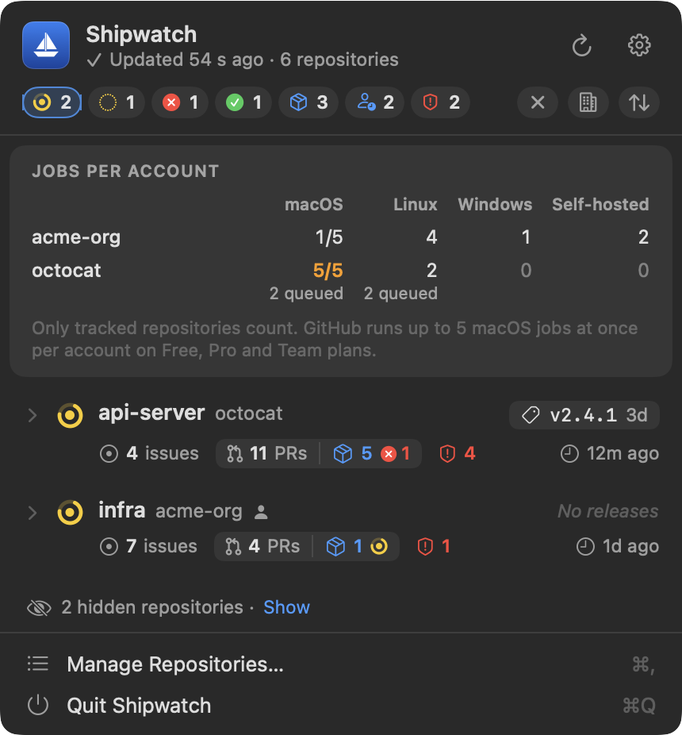
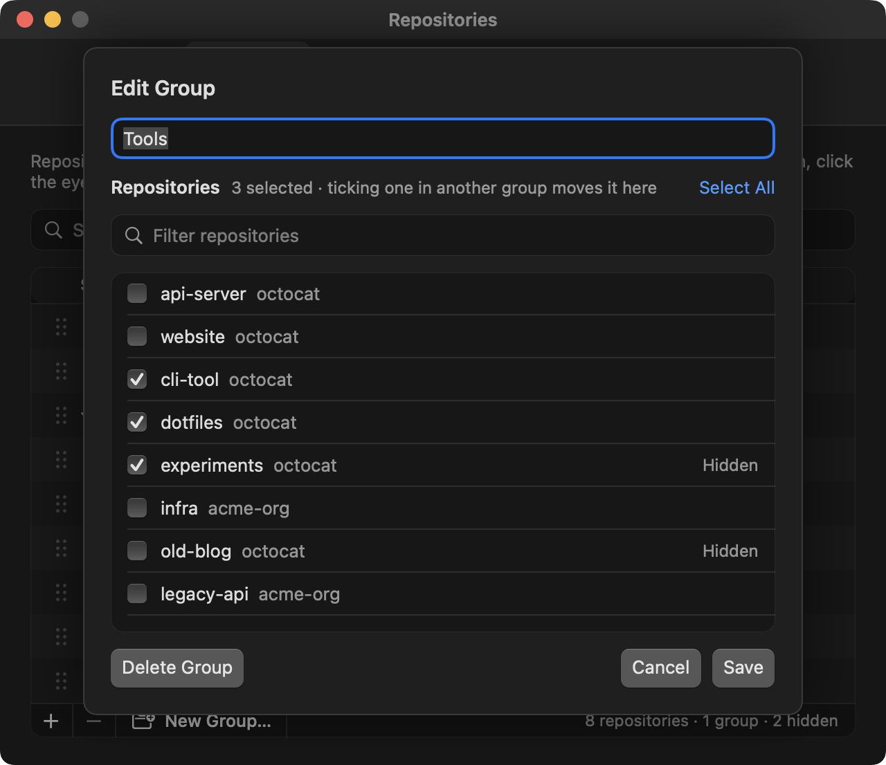
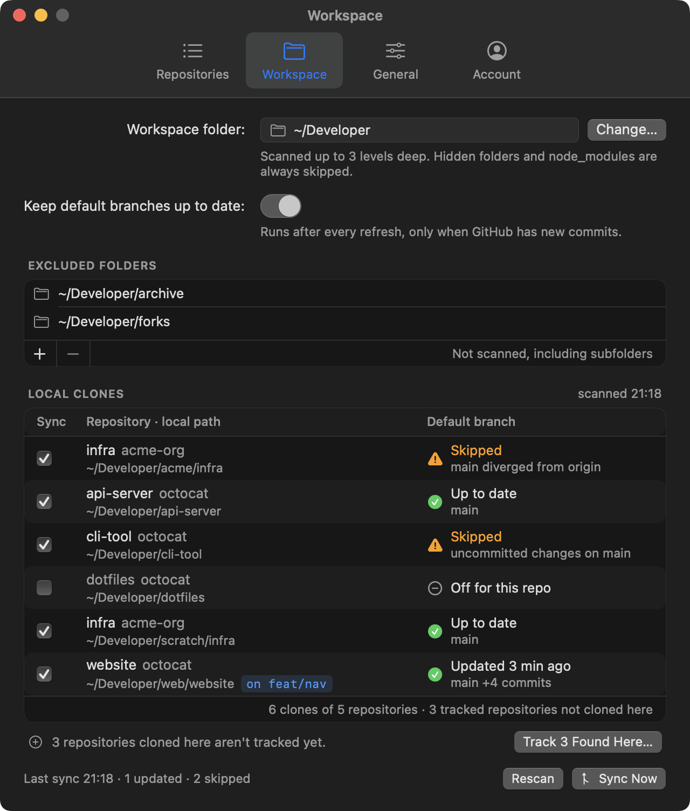
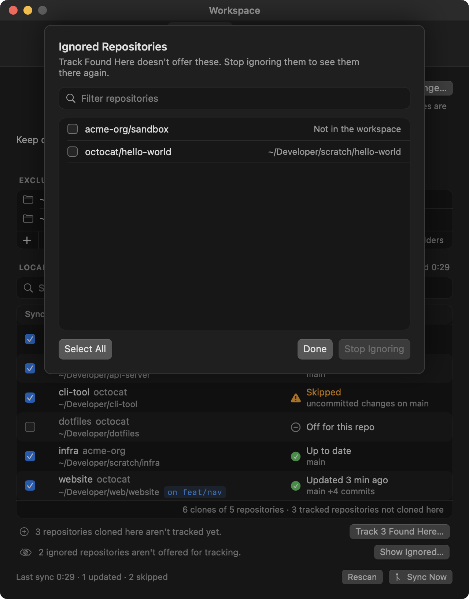

# Usage

## Menu bar

Shipwatch shows a sailboat in the menu bar.

| Icon | Meaning |
| --- | --- |
| Sailboat only | Nothing is running; repositories may be passing, queued, failing or config/billing |
| Yellow dot | A workflow is running in a visible repository |

By default the number of repositories with a running workflow shows next to the
sailboat; repositories that only have queued workflows don't count. **Show count in menu bar** switches it to failing repositories or
turns it off. Left-click the sailboat to open the list. Right-click it for
**Refresh** (Cmd-R), **Settings…** (Cmd-comma), **Check for Updates…** and
**Quit Shipwatch** (Cmd-Q). When a newer Shipwatch is out, a line above
**Manage Repositories…** offers **Install**; see [Updates](updates.md).
The same shortcuts work while the list is open.

## Repository rows

  

Each visible repository shows:

| Item | Click to open |
| --- | --- |
| `owner/name` | the repository |
| Latest release tag and age (or **No releases**) | that release |
| Actions status: checkmark passing, xmark failing, exclamation mark config/billing, spinning ring running, dotted circle queued | expands the row with running runs, queued runs and the latest run per workflow on the default branch; each run links to GitHub |
| Open issues | the open issues list |
| Open pull requests | the open pull requests list |
| `N dependabot` | open pull requests by `app/dependabot`, with their [CI](#dependabot-ci); just the icon, number and CI mark when the line is full |
| `N to review`, with [review requests](#review-requests) on | open pull requests waiting for your review |
| Shield, with [security alerts](#security-alerts) on | the repository's Security tab |
| Last activity | (hover for the exact date) |

A person after the name means the row only counts what is yours; see
[Only mine](#only-mine). With a [workspace folder](#workspace), the expanded row
also shows the repository's [lines of code](#lines-of-code).

Failing means the latest completed run of any workflow on the default branch
failed. A red run that was fixed by a later run is ignored. Running beats
queued, queued beats failing, failing beats config/billing, config/billing beats passing.

**Config/billing** (orange exclamation mark) means the latest runs failed before
any job ran: GitHub failed every job without assigning a runner, or the workflow
file is invalid (`startup_failure`). That is what happens when a payment failed or
the Actions spending limit is reached, and also when a job's configuration (for
example `runs-on` or a matrix) can't be evaluated. Shipwatch can't tell the two
apart without the Checks permission, so open the run to see GitHub's message.

**Queued** (dotted yellow circle) means a run is waiting to start, for a runner,
an approval or a concurrency slot, and none is in progress. Queued repositories
are not counted as running and don't show the menu bar dot.

The chips under the title count running, queued, failing, config/billing and passing
repositories, repositories with at least one open Dependabot pull request,
repositories with pull requests waiting for your review (with
[review requests](#review-requests) on), and, with
[security alerts](#security-alerts) on, repositories with at least one open
alert. Click one to list only those repositories; click it again to show all of
them. The chosen chip stays on when the list closes and across launches. When
the chips don't fit, they show only icons and numbers; hover for the label.
When even those don't fit, scroll them sideways.

### Dependabot CI

After the Dependabot count, a mark shows the GitHub Actions runs on the latest
commit of each open Dependabot pull request: a red cross and how many fail, else
a spinning ring while one runs, a dotted circle while one is queued, or a green
check when they all pass. Hover the count for the breakdown. A pull request
fails like on GitHub: when the latest run of any workflow (per event) on that
commit didn't succeed, wasn't skipped and wasn't neutral, so cancelled and timed
out runs count as failing. Group rows add up their repositories.

Only GitHub Actions runs count, not checks from other CI services, and only the
first 20 open Dependabot pull requests of each repository; the others show as
"not checked" in the tooltip. Without Actions access to a repository, there is
no mark.

### Jobs per account

While the **running** or **queued** chip is on, a **Jobs per account** section
above the list counts the jobs running right now in each organization or user's
tracked repositories, per kind of runner: macOS, Linux, Windows, self-hosted and
other. Queued jobs, the ones waiting for a runner, show under each number.

  

macOS shows against the limit GitHub sets per account: 5 jobs at once on the
Free, Pro and Team plans, shared by standard and larger runners. It turns orange
when an account reaches it, which is usually why macOS jobs sit in the queue.
Enterprise accounts can run 50, but GitHub only shows the plan to owners, so
Shipwatch always assumes 5. Your own repositories are an account of their own.

- Only tracked repositories count, hidden ones included. Jobs in an account's
  other repositories use the same limit, so the real numbers can be higher. For
  repositories that count [only yours](#only-mine), only your runs count.
- The kind comes from each job's `runs-on` labels: `macos-…`, `ubuntu-…` and
  `windows-…` are GitHub's hosted runners, larger ones included, and
  `self-hosted` runners don't use GitHub's limits. Larger runners picked by a
  custom label or a runner group show as **Other**.
- While an account is chosen in the building menu, only that account shows.

The jobs are only read while one of the two chips is on: one request per running
or queued workflow run on each refresh, every 20 seconds while workflows run.
Clicking a chip refreshes right away. When a run's jobs can't be read, the
section says so instead of showing a smaller number.

### Security alerts

Off by default. Turn on **Show security alerts** in Settings > General to count
open Dependabot, code scanning and secret scanning alerts. Each row then shows a
shield:

| Shield | Meaning |
| --- | --- |
| Red, with a number | open alerts; hover for the count per kind |
| `?` | none of the kinds Shipwatch could read has an open alert, but at least one kind couldn't be read |
| Dimmed `0` | every kind was read and none has an open alert |

Click the shield to open the repository's Security tab. The **with alerts** chip
lists only repositories with open alerts; repositories showing `?` don't count.
Code and secret scanning counts stop at 100, shown as `100+`.

Dependabot and code scanning alerts need write access to the repository, secret
scanning alerts need admin access (organization owners and security managers can
read all of them), private repositories need GitHub Advanced Security for code and
secret scanning, and each kind has to be turned on for the repository. When one of these
is missing, that kind is unknown, never 0. With the GitHub App, the app also needs
the [alert permissions](github-app-setup.md#security-alert-permissions).

Each refresh then sends two more requests per repository, for code and secret
scanning; unchanged results come back as `304 Not Modified` and don't use rate
limit. Kinds GitHub refuses to show are asked again only every 15 minutes, or
right away when you turn the setting off and on.

With more than one organization or user among the shown repositories, the
building button before the sort arrows narrows the list to one of them. It
offers **All Organizations** (the default) and each owner with how many
repositories it has. While one is chosen, the button shows its name in blue, and
the chips, groups and **Move Up** and **Move Down** only count that owner's
repositories. The menu bar icon still counts every repository. The choice is
kept across launches.

While a chip or an organization narrows the list, an **×** button before the
building button resets both and lists every repository again.

The arrows at the end of the chips sort the list:

| Order | Lists |
| --- | --- |
| Custom (default) | the order from Settings > Repositories |
| Name | groups and repositories alphabetically |
| Last Activity | most recent first, as set in **Last activity means**; a group counts its most recent repository |

Groups keep their repositories together in every order, sorted the same way
inside the group. The arrows turn blue while the order isn't Custom.

## Groups

  

A group shows as one row: its name, how many repositories it holds, the open
issues and pull requests (and Dependabot pull requests and security alerts)
summed over them, and the most recent activity. Instead of a release, it shows how many of its
repositories are running, queued, failing, config/billing or unreadable, or **all green**
when every repository with workflows passes. The icon in front shows what needs
attention first: failing, then config/billing, then running, then queued, then
passing.

- Click the row to expand it and see each repository as usual; click again to
  collapse. Shipwatch remembers which groups are open.
- The issue and pull request counts open a GitHub search across the group's
  repositories.
- While a status chip filters the list, groups stay open and list only their
  matching repositories.
- Right-click a group for **Expand** or **Collapse**, **Open Issues**,
  **Open Pull Requests**, **Move Up**, **Move Down** and **Edit Group…**, which
  opens the group sheet in Settings.

Hidden repositories don't count, and a group whose repositories are all hidden
isn't shown, until **Show** at the bottom of the list is on.

Right-click a row for **Open Repository**, **Open Actions**, **Open Releases**,
**Open Security** (with security alerts on), **Copy Latest Tag**, **Move Up**, **Move Down**, **Hide** and
**Remove from Shipwatch…**. **Move Up** and **Move Down** change the custom
order, so they only work while the list is sorted by Custom, and move a grouped
repository within its group. Removing or hiding never changes anything on GitHub.
When the repository has clones in your [workspace](#workspace), the menu also
offers **Update Local Clone Now** and **Show Local Clone in Finder**.

When clone sync skips or fails on a clone, a line at the bottom of the list says
"N local clones skipped". Click **Review** to see why in Settings > Workspace.

## Settings

Open Settings with **Manage Repositories…** (Cmd-comma) at the bottom of the list, or
**Settings…** in the right-click menu.

### Repositories

The repositories shown in the list, in order.

- Click **+** to pick repositories your token can read. Filter the list, or type
  `owner/name` to add one that isn't listed.
- Type in **Search repositories and groups** to list only repositories whose
  `owner/name` contains the text, under their group, and every repository of a
  group whose name contains it. Groups stay open while searching. Clear the
  search to drag rows again.
- Drag rows to reorder. Drag a group's header row to move the whole group.
- Click **New Group…** at the bottom to create a group: name it and tick its
  repositories (the selected ones are ticked already). Filter the list and use
  **Select All** to pick many at once. Ticking a repository that is in another
  group moves it.
- **Edit…** on a group's row opens the same sheet to rename the group, change its
  repositories or **Delete Group**. You can also click a group's name to rename
  it in place.
- The **Group** column puts a repository, or every selected one, in a group,
  takes it out with **None**, or starts a **New Group…** with it. Dragging a
  repository into a group, and right-clicking it for **Move to Group** and
  **Remove from Group**, work too. A repository dropped right below a group's
  last repository stays outside the group unless it was already in it.
- Click the arrow in front of a group to collapse it in Settings, so the other
  repositories are easier to see. Right-click a group for **Collapse All Groups**
  and **Expand All Groups**. This doesn't change whether the group is open in the
  menu.
- **Ungroup** on a group's row, or selecting it and clicking **-**, deletes the
  group only: its repositories stay, ungrouped.

  

- Click the eye to hide or show a repository. Hidden ones stay configured and are
  counted at the bottom of the list.
- Click the bell to get a [release notification](#release-notifications) when the
  repository publishes a GitHub release. Right-click selected rows for
  **Notify About New Releases** to turn it on for all of them.
- Click the person to count [only yours](#only-mine) for the repository.
  Right-click selected rows for **Show Only My Issues, PRs and Runs** to turn it
  on for all of them.
- Select rows and click **-** (or press Delete), or right-click a repository and
  choose **Remove from Shipwatch…**, to stop tracking it. A right-click on a
  selected row acts on every selected repository. Shipwatch asks first; the
  repository stays on GitHub and its local clones stay on disk, so you can add
  it again later. With a workspace folder set, **Remove and Ignore** also keeps
  its clones out of [Track N Found Here](#ignored-repositories).
- The **Access** column shows whether the current sign-in can read each
  repository. **Grant…** opens the GitHub App installation page.

#### Renamed and transferred repositories

GitHub still answers for a repository's old name after it is renamed or moved to
another owner. When it reports a new name, Shipwatch switches the entry to it on
its own, keeping its place, group, hidden state and clone sync setting, and
refreshes once more so the Dependabot count uses the new name. Local clones whose
remote still uses the old name keep matching it.

This only works while your sign-in can still read the repository. If it moved to
an owner where the GitHub App isn't installed, the row says Shipwatch can't read
it: click **Grant access…** and add it to the installation there.

### Workspace

Optionally keeps the default branch (usually `main`) of your local clones in
step with GitHub, so it is current whenever you branch off it. Commit on feature
branches: Shipwatch only fast-forwards and never creates commits, resets,
stashes, forces, pushes or switches branches.

1. Click **Choose…** and pick the folder where you keep your clones, for example
   `~/Developer`. Shipwatch scans it up to 3 levels deep for folders whose git
   remote points at a repository you track on github.com. Nothing on disk
   changes yet.
2. When the folder holds clones of github.com repositories you don't track yet,
   a line under the table says how many. Click **Track N Found Here…**, untick
   any you don't want (all are ticked at first), and click
   **Track N Repositories**. They are added to Settings > Repositories like
   repositories added with **+**. Click **Ignore N** instead to stop offering
   the ticked ones; see [Ignored repositories](#ignored-repositories). Filter
   the list to find a repository by name or path; both buttons only act on the
   ticked repositories the filter shows.
3. Optionally add **Excluded folders** with **+**. Shipwatch doesn't scan them or
   anything inside them. Hidden folders, `node_modules`, symlinks and app
   bundles are always skipped.
4. Turn on **Keep default branches up to date** (default off).

  

  

After every refresh where GitHub reports a new commit on a default branch,
Shipwatch fetches that branch and fast-forwards the local one. A clone is
skipped, with the reason in the **Local clones** table, when:

| Reason | What to do |
| --- | --- |
| uncommitted changes on main | Commit, stash or discard them. Untracked files don't count. |
| main diverged from origin | The local branch has commits that aren't on GitHub. Move them to a branch. |
| rebase of main in progress | Finish or abort the rebase. |
| no local main branch | Nothing to update. Check it out once if you want it kept current. |

Errors such as an unreachable remote or a key that needs a passphrase show as
failed; Shipwatch retries them after 15 minutes. See
[Troubleshooting](troubleshooting.md#a-local-clone-was-skipped-or-failed).

- Untick a repository's **Sync** checkbox to leave all its clones alone.
- A clone on another branch still gets its default branch updated without
  switching; the table shows "on *branch*".
- **Sync Now** rescans and updates every clone right away, ignoring the
  15 minute wait. **Rescan** only looks for clones again.
- Type in **Search clones by repository or path** to list only matching clones.
- Right-click a clone for **Show in Finder**, or **Remove from Shipwatch…** to
  stop tracking its repository. The clone stays on disk. **Remove** puts it back
  among the repositories that aren't tracked yet, so **Track N Found Here…** can
  add it again; **Remove and Ignore** also [ignores](#ignored-repositories) it.

#### Ignored repositories

An ignored repository isn't offered by **Track N Found Here…** and isn't counted
in the "aren't tracked yet" line, even though its clone stays on disk. Ignore
repositories with **Ignore N** in that sheet, or with **Remove and Ignore** when
removing a tracked repository (in Repositories or Workspace, while a workspace
folder is set).

A line under the clones table says how many are ignored. Click
**Show Ignored…**, tick repositories and click **Stop Ignoring N** to offer them
again. Adding an ignored repository with **+** stops ignoring it too.

  

Shipwatch needs git for this: Homebrew's, or Apple's from the Command Line Tools
(`xcode-select --install`). It uses your existing SSH agent or credential
helper and never prompts.

#### Lines of code

With a workspace folder set, Shipwatch counts the lines of code of each tracked
repository it finds a clone of, once a week. Expand the repository's row in the
list: **Lines of code** shows this week's count and the change since last week's,
in lines and percent. The collapsed row doesn't show it.

| Line | Counts |
| --- | --- |
| Code | Programming and markup languages, as in GitHub's language bar: Swift, JavaScript, TypeScript, Python, Go, HTML, CSS, shell, Dockerfiles, Terraform, SQL and so on. |
| Tests | Code files in folders named like `test`, `tests`, `__tests__`, `spec`, `e2e`, `testdata`, `fixtures`, `mocks` or `AppTests`, and files named like `api.test.ts`, `api.spec.js`, `client_test.go`, `test_api.py` or `ApiTests.swift`. |
| Total | Code plus tests. |
| Markdown | `.md`, `.markdown` and `.mdx` files, kept apart and not part of the total. |

- Shipwatch reads the files committed on the clone's local default branch
  (usually `main`) with `git grep`. Uncommitted changes and other branches don't
  count, and nothing is fetched: turn on **Keep default branches up to date**,
  or pull, to count what is on GitHub. With several clones of a repository, the
  first one (by path) that has the branch is counted.
- Lines that are empty or only whitespace don't count; comments do.
- Data and config files (JSON, YAML, TOML, XML), plain text, lockfiles, binary,
  minified and generated files, and anything inside `node_modules`, `vendor`,
  `third_party`, `Pods`, `Carthage` or `dist` don't count.
- The rules only look at file names, so the same commit always gives the same
  numbers. The branch and commit that were counted show above the numbers.

The first count of a repository is its baseline. Repositories you already track
get theirs on the first refresh after updating to a Shipwatch with line counts;
repositories you add later, on the first refresh after adding them. Then a new
count runs on the first refresh of each week (weeks start on Monday), and the
change compares it with the count before. Only those two counts are kept: if
Shipwatch didn't run for a while, the change covers the time since the date under
the numbers. Removing a repository drops its counts, so adding it again starts
from a new baseline.

Partial clones (`git clone --filter=...`) aren't counted, since reading them
would download files. When a count fails, the expanded row says why, and
Shipwatch tries again after 15 minutes.

### General

| Setting | Default | Effect |
| --- | --- | --- |
| Repositories | Info only | How many repositories, groups and hidden ones you track, how long the last refresh took, and **Manage…** to open Repositories. See [How many repositories](#how-many-repositories). |
| Refresh every | 2 minutes | 1, 2, 5, 10 or 15 minutes. While a workflow runs or is queued, Shipwatch refreshes every 20 seconds. |
| Last activity means | Last push | **Last push**, or **Any update** (issues, pull requests, comments). |
| Include pre-releases | Off | Show the newest release even if it is a pre-release. |
| Show security alerts | Off | Count open Dependabot, code scanning and secret scanning alerts. See [Security alerts](#security-alerts). |
| Only mine everywhere | Off | Count only what is yours in every repository. See [Only mine](#only-mine). |
| Review requests | Off | **All requests** or **Needing approval**. See [Review requests](#review-requests). |
| Release notifications | Off | Shows for how many repositories the bell is on. See [Release notifications](#release-notifications). |
| Show count in menu bar | Running | Show the number of **Running** or **Failing** repositories next to the sailboat, or **None**. |
| Launch at login | On after the first launch from Applications | Start Shipwatch when you log in. Only available for the app bundle. |
| Check automatically | On, every 6 hours | Check GitHub Releases for a newer Shipwatch every hour, 6 hours, 12 hours or day. |
| Install automatically | Off | Install a verified update found by a scheduled check, then restart. |

The same tab shows the installed **Version**, the **Updates** status, **Check Now**
and, when a newer release exists, **Install vX.Y.Z and Restart**. Builds run from
source show "Development build" and can't update themselves. See
[Updates](updates.md).

Shipwatch also refreshes when you open the list and the data is older than
60 seconds, and a few seconds after the Mac wakes. After a relaunch, such as an
update, the list shows the last refresh right away and refreshes on schedule.
When GitHub rate limits the token, it waits for the reset time. Details are in
[Architecture](architecture.md#refresh-cadence).

### Account

- The signed-in user, the sign-in method and the GitHub App permissions granted,
  including the alert permissions while security alerts are on.
- **Manage Repository Access…** opens the app installation, where you choose
  which repositories Shipwatch can read.
- **Sign In…** and **Sign Out**. Signing out deletes the Keychain token.
- **Use GitHub CLI token if app sign-in is unavailable** (default off): reuse
  `gh auth token` when there is no GitHub App token. The token is kept in memory
  only.
- **GitHub App** Client ID and slug: only for builds without a bundled app, or to
  use your own. See [GitHub App setup](github-app-setup.md).

### How many repositories

Shipwatch stays quick with up to about 50 repositories and works well up to
about 100. Every refresh reads each tracked repository, hidden ones too, at
roughly a second each, so with 100 a refresh takes about 2 minutes, and the
20 second refresh while a workflow runs can't keep up. GitHub's rate limits
aren't the bottleneck: each refresh costs about one GraphQL point per 10
repositories, and unchanged workflow runs come back as `304` and are free. Each
open Dependabot pull request (up to 20 per repository) adds one more call for
the runs on its latest commit, also free while they don't change. The
limit is shared with `gh` and your other tools, though. Above 100, Settings >
General says so in orange. Remove the repositories you don't need; hiding them
doesn't make refreshes faster.

### Only mine

Off by default. Turn it on for single repositories with the person in Settings >
Repositories, or for all of them with **Only mine everywhere** in Settings >
General. Those repositories then only count:

- open issues and pull requests **assigned** to you, including Dependabot pull
  requests;
- workflow runs **you triggered** (GitHub's `actor`): the Actions status, the
  running and queued runs and the latest run per workflow on the default branch
  only look at those. With none of yours, the row has no Actions status. The
  [Dependabot CI](#dependabot-ci) of your Dependabot pull requests still counts
  every run on their latest commit, since Dependabot triggers them.

The rows show a person after the name, and their links open GitHub filtered the
same way (`assignee:` for issues and pull requests, `actor:` for Actions). A
group's links are only filtered when all its repositories count only yours. The
release, last activity and security alerts stay the repository's own. The
running dot and count in the menu bar follow the same counts, so they only light
up for your runs. Each such repository needs one more search per refresh for its
pull requests.

### Review requests

Off by default. Pick **All requests** or **Needing approval** for **Review
requests** in Settings > General to count the open pull requests where your
review is requested, directly or through a team:

- **All requests**: every one still waiting for you. GitHub drops the request
  once you review, so reviewed pull requests leave the count.
- **Needing approval**: only those that can't be merged before an approving
  review, because branch protection or a ruleset requires one and it hasn't been
  given yet (`review:required` on GitHub).

Each row shows **N to review** in its pull request pill, linking to that list on
GitHub, and groups add theirs up. The **to review** chip lists only the
repositories that have any. It takes one more search per refresh, across all
repositories at once, and counts up to 500 pull requests.

### Release notifications

Off by default. Click the bell next to a repository in Settings > Repositories,
and Shipwatch shows a macOS notification, with its icon, when that repository
publishes a GitHub release:

- Only GitHub Releases count. Pushing a tag without creating a release, and
  draft releases, don't notify. Pre-releases only count while
  **Include pre-releases** is on.
- Shipwatch finds the release on its next refresh, so the notification can come
  up to one refresh interval later. A release published while Shipwatch wasn't
  running is announced on the first refresh after it starts again.
- A release that becomes the latest without being new, for example after a
  newer one was deleted or after turning on **Include pre-releases**, doesn't
  notify.
- Click the notification to open the release on GitHub. More than three new
  releases at once arrive as one notification.

The first bell you turn on makes macOS ask whether Shipwatch may send
notifications. Settings > General shows for how many repositories the bell is on,
**Choose…** to go to the Repositories tab, and **Send Test** to see one. If
notifications are off for Shipwatch in System Settings, it says so with a button
to open them. Notifications need the app bundle; they aren't available when
running from source with `swift run`.

## Where data is stored

| What | Where |
| --- | --- |
| GitHub App token | login Keychain, service `dev.mbianchi.shipwatch` |
| Repositories, groups and settings, including the list order, workspace folder, exclusions and ignored repositories | `UserDefaults` domain `dev.mbianchi.shipwatch` |
| Update state and lock, statuses of the last refresh, weekly lines of code | `~/Library/Application Support/Shipwatch` |
| GitHub CLI token | memory only |

Shipwatch sends no analytics. It only talks to `api.github.com`, `github.com`
and GitHub's release download hosts. With clone sync on, git also fetches from
your clones' github.com remotes, using your own git credentials.
