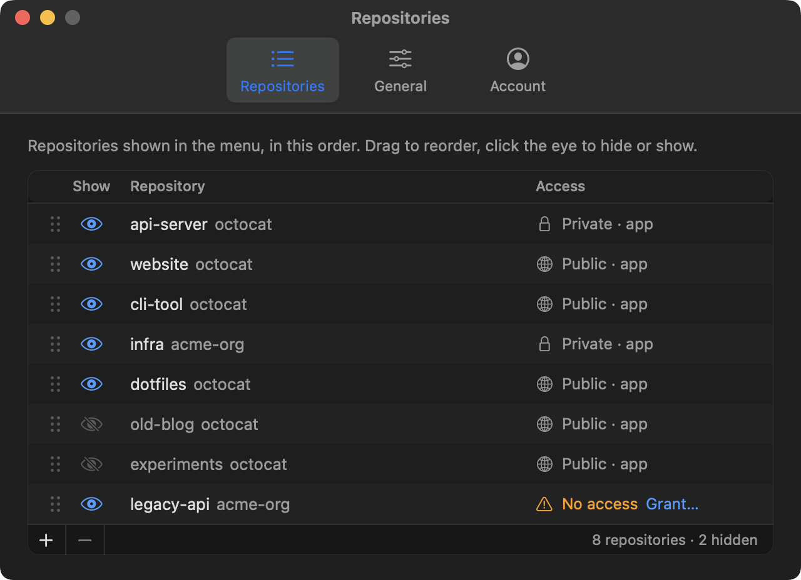
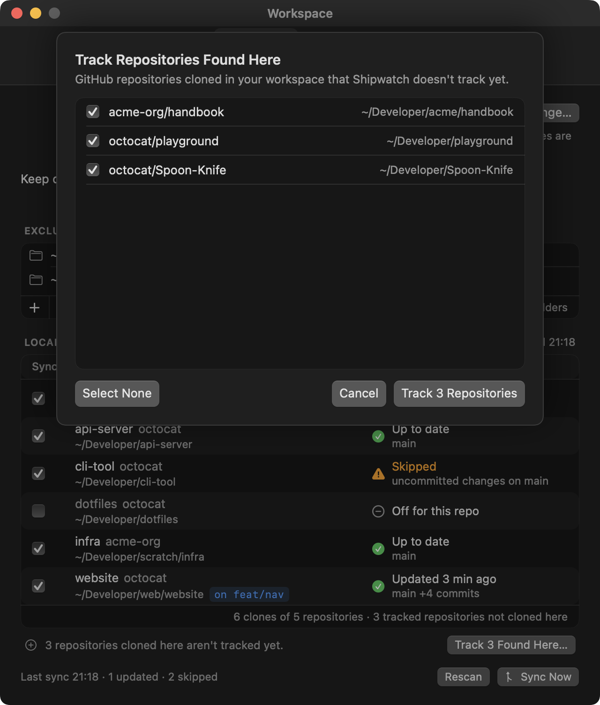

# Usage

## Menu bar

Shipwatch shows a sailboat in the menu bar.

| Icon | Meaning |
| --- | --- |
| Sailboat only | Nothing is running; repositories may be passing, failing or config/billing |
| Yellow dot | A workflow is running or queued in a visible repository |

By default the number of repositories with a running workflow shows next to the
sailboat. **Show count in menu bar** switches it to failing repositories or
turns it off. Left-click the sailboat to open the list. Right-click it for
**Refresh** (Cmd-R), **Settings…** (Cmd-comma), **Check for Updates…** and
**Quit Shipwatch** (Cmd-Q). When a newer Shipwatch is out, a line above
**Manage Repositories…** offers **Install**; see [Updates](updates.md).
The same shortcuts work while the list is open.

## Repository rows

  

Each visible repository shows:

| Item | Click to open |
| --- | --- |
| `owner/name` | the repository |
| Latest release tag and age (or **No releases**) | that release |
| Actions status: checkmark passing, xmark failing, exclamation mark config/billing, dotted circle running | expands the row with running runs and the latest run per workflow on the default branch; each run links to GitHub |
| Open issues | the open issues list |
| Open pull requests | the open pull requests list |
| `N dependabot` | open pull requests by `app/dependabot`; just the icon and number when the line is full |
| Shield, with [security alerts](#security-alerts) on | the repository's Security tab |
| Last activity | (hover for the exact date) |

Failing means the latest completed run of any workflow on the default branch
failed. A red run that was fixed by a later run is ignored. Running beats
failing, failing beats config/billing, config/billing beats passing.

**Config/billing** (orange exclamation mark) means the latest runs failed before
any job ran: GitHub failed every job without assigning a runner, or the workflow
file is invalid (`startup_failure`). That is what happens when a payment failed or
the Actions spending limit is reached, and also when a job's configuration (for
example `runs-on` or a matrix) can't be evaluated. Shipwatch can't tell the two
apart without the Checks permission, so open the run to see GitHub's message.

The chips under the title count running, failing, config/billing and passing
repositories, repositories with at least one open Dependabot pull request, and,
with [security alerts](#security-alerts) on, repositories with at least one open
alert. Click one to list only those repositories; click it again, or close the
list, to show all of them. When the chips don't fit, they show only icons and
numbers; hover for the label.

### Security alerts

Off by default. Turn on **Show security alerts** in Settings > General to count
open Dependabot, code scanning and secret scanning alerts. Each row then shows a
shield:

| Shield | Meaning |
| --- | --- |
| Red, with a number | open alerts; hover for the count per kind |
| `?` | none of the kinds Shipwatch could read has an open alert, but at least one kind couldn't be read |
| Dimmed `0` | every kind was read and none has an open alert |

Click the shield to open the repository's Security tab. The **with alerts** chip
lists only repositories with open alerts; repositories showing `?` don't count.
Code and secret scanning counts stop at 100, shown as `100+`.

Dependabot and code scanning alerts need write access to the repository, secret
scanning alerts need admin access (organization owners and security managers can
read all of them), private repositories need GitHub Advanced Security for code and
secret scanning, and each kind has to be turned on for the repository. When one of these
is missing, that kind is unknown, never 0. With the GitHub App, the app also needs
the [alert permissions](github-app-setup.md#security-alert-permissions).

Each refresh then sends two more requests per repository, for code and secret
scanning; unchanged results come back as `304 Not Modified` and don't use rate
limit. Kinds GitHub refuses to show are asked again only every 15 minutes, or
right away when you turn the setting off and on.

The arrows at the end of the chips sort the list:

| Order | Lists |
| --- | --- |
| Custom (default) | the order from Settings > Repositories |
| Name | groups and repositories alphabetically |
| Last Activity | most recent first, as set in **Last activity means**; a group counts its most recent repository |

Groups keep their repositories together in every order, sorted the same way
inside the group. The arrows turn blue while the order isn't Custom.

## Groups

  

A group shows as one row: its name, how many repositories it holds, the open
issues and pull requests (and Dependabot pull requests and security alerts)
summed over them, and the most recent activity. Instead of a release, it shows how many of its
repositories are running, failing, config/billing or unreadable, or **all green**
when every repository with workflows passes. The icon in front shows what needs
attention first: failing, then config/billing, then running, then passing.

- Click the row to expand it and see each repository as usual; click again to
  collapse. Shipwatch remembers which groups are open.
- The issue and pull request counts open a GitHub search across the group's
  repositories.
- While a status chip filters the list, groups stay open and list only their
  matching repositories.
- Right-click a group for **Expand** or **Collapse**, **Open Issues**,
  **Open Pull Requests**, **Move Up**, **Move Down** and **Edit Groups…**.

Hidden repositories don't count, and a group whose repositories are all hidden
isn't shown, until **Show** at the bottom of the list is on.

Right-click a row for **Open Repository**, **Open Actions**, **Open Releases**,
**Open Security** (with security alerts on), **Copy Latest Tag**, **Move Up**, **Move Down**, **Hide** and
**Remove from Shipwatch…**. **Move Up** and **Move Down** change the custom
order, so they only work while the list is sorted by Custom, and move a grouped
repository within its group. Removing or hiding never changes anything on GitHub.
When the repository has clones in your [workspace](#workspace), the menu also
offers **Update Local Clone Now** and **Show Local Clone in Finder**.

When clone sync skips or fails on a clone, a line at the bottom of the list says
"N local clones skipped". Click **Review** to see why in Settings > Workspace.

## Settings

Open Settings with **Manage Repositories…** (Cmd-comma) at the bottom of the list, or
**Settings…** in the right-click menu.

### Repositories

The repositories shown in the list, in order.

- Click **+** to pick repositories your token can read. Filter the list, or type
  `owner/name` to add one that isn't listed.
- Drag rows to reorder. Drag a group's header row to move the whole group.
- Click the folder button at the bottom to create a group, with the selected
  repositories if any, and type its name. Click a group's name to rename it.
- Drag a repository into a group, or right-click it for **Move to Group** and
  **Remove from Group**. A repository dropped right below a group's last
  repository stays outside the group unless it was already in it.
- **Ungroup** on a group's row, or selecting it and clicking **-**, deletes the
  group only: its repositories stay, ungrouped.
- Click the eye to hide or show a repository. Hidden ones stay configured and are
  counted at the bottom of the list.
- Select rows and click **-** to remove them from Shipwatch.
- The **Access** column shows whether the current sign-in can read each
  repository. **Grant…** opens the GitHub App installation page.

#### Renamed and transferred repositories

GitHub still answers for a repository's old name after it is renamed or moved to
another owner. When it reports a new name, Shipwatch switches the entry to it on
its own, keeping its place, group, hidden state and clone sync setting, and
refreshes once more so the Dependabot count uses the new name. Local clones whose
remote still uses the old name keep matching it.

This only works while your sign-in can still read the repository. If it moved to
an owner where the GitHub App isn't installed, the row says Shipwatch can't read
it: click **Grant access…** and add it to the installation there.

### Workspace

Optionally keeps the default branch (usually `main`) of your local clones in
step with GitHub, so it is current whenever you branch off it. Commit on feature
branches: Shipwatch only fast-forwards and never creates commits, resets,
stashes, forces, pushes or switches branches.

1. Click **Choose…** and pick the folder where you keep your clones, for example
   `~/Developer`. Shipwatch scans it up to 3 levels deep for folders whose git
   remote points at a repository you track on github.com. Nothing on disk
   changes yet.
2. When the folder holds clones of github.com repositories you don't track yet,
   a line under the table says how many. Click **Track N Found Here…**, untick
   any you don't want (all are ticked at first), and click
   **Track N Repositories**. They are added to Settings > Repositories like
   repositories added with **+**.
3. Optionally add **Excluded folders** with **+**. Shipwatch doesn't scan them or
   anything inside them. Hidden folders, `node_modules`, symlinks and app
   bundles are always skipped.
4. Turn on **Keep default branches up to date** (default off).

  

  

After every refresh where GitHub reports a new commit on a default branch,
Shipwatch fetches that branch and fast-forwards the local one. A clone is
skipped, with the reason in the **Local clones** table, when:

| Reason | What to do |
| --- | --- |
| uncommitted changes on main | Commit, stash or discard them. Untracked files don't count. |
| main diverged from origin | The local branch has commits that aren't on GitHub. Move them to a branch. |
| rebase of main in progress | Finish or abort the rebase. |
| no local main branch | Nothing to update. Check it out once if you want it kept current. |

Errors such as an unreachable remote or a key that needs a passphrase show as
failed; Shipwatch retries them after 15 minutes. See
[Troubleshooting](troubleshooting.md#a-local-clone-was-skipped-or-failed).

- Untick a repository's **Sync** checkbox to leave all its clones alone.
- A clone on another branch still gets its default branch updated without
  switching; the table shows "on *branch*".
- **Sync Now** rescans and updates every clone right away, ignoring the
  15 minute wait. **Rescan** only looks for clones again.
- Right-click a clone for **Show in Finder**.

Shipwatch needs git for this: Homebrew's, or Apple's from the Command Line Tools
(`xcode-select --install`). It uses your existing SSH agent or credential
helper and never prompts.

### General

| Setting | Default | Effect |
| --- | --- | --- |
| Refresh every | 2 minutes | 1, 2, 5, 10 or 15 minutes. While a workflow runs, Shipwatch refreshes every 20 seconds. |
| Last activity means | Last push | **Last push**, or **Any update** (issues, pull requests, comments). |
| Include pre-releases | Off | Show the newest release even if it is a pre-release. |
| Show security alerts | Off | Count open Dependabot, code scanning and secret scanning alerts. See [Security alerts](#security-alerts). |
| Show count in menu bar | Running | Show the number of **Running** or **Failing** repositories next to the sailboat, or **None**. |
| Launch at login | On after the first launch from Applications | Start Shipwatch when you log in. Only available for the app bundle. |
| Check automatically | On, every 6 hours | Check GitHub Releases for a newer Shipwatch every hour, 6 hours, 12 hours or day. |
| Install automatically | Off | Install a verified update found by a scheduled check, then restart. |

The same tab shows the installed **Version**, the **Updates** status, **Check Now**
and, when a newer release exists, **Install vX.Y.Z and Restart**. Builds run from
source show "Development build" and can't update themselves. See
[Updates](updates.md).

Shipwatch also refreshes when you open the list and the data is older than
60 seconds, and a few seconds after the Mac wakes. When GitHub rate limits the
token, it waits for the reset time. Details are in
[Architecture](architecture.md#refresh-cadence).

### Account

- The signed-in user, the sign-in method and the GitHub App permissions granted,
  including the alert permissions while security alerts are on.
- **Manage Repository Access…** opens the app installation, where you choose
  which repositories Shipwatch can read.
- **Sign In…** and **Sign Out**. Signing out deletes the Keychain token.
- **Use GitHub CLI token if app sign-in is unavailable** (default off): reuse
  `gh auth token` when there is no GitHub App token. The token is kept in memory
  only.
- **GitHub App** Client ID and slug: only for builds without a bundled app, or to
  use your own. See [GitHub App setup](github-app-setup.md).

## Where data is stored

| What | Where |
| --- | --- |
| GitHub App token | login Keychain, service `dev.mbianchi.shipwatch` |
| Repositories, groups and settings, including the list order, workspace folder and exclusions | `UserDefaults` domain `dev.mbianchi.shipwatch` |
| Update state and lock | `~/Library/Application Support/Shipwatch` |
| GitHub CLI token | memory only |

Shipwatch sends no analytics. It only talks to `api.github.com`, `github.com`
and GitHub's release download hosts. With clone sync on, git also fetches from
your clones' github.com remotes, using your own git credentials.
